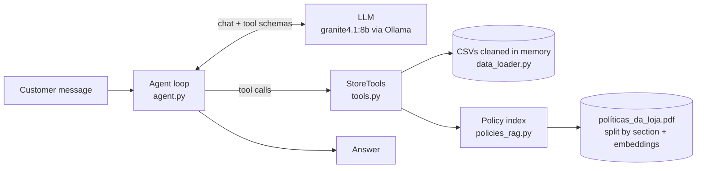

# Empório da Música — AI Customer Service Agent

Prototype of a text-message customer service agent for Empório da Música, a fictional musical instrument store in Campo Grande/MS (Artefact AI Engineer technical case).

The agent ("Melodia") talks to customers in Brazilian Portuguese, answers with live data (catalog, prices, stock, promotions, order status) and with the store policy manual (returns, warranty, shipping, payment), and politely handles out-of-scope requests.

- **Language:** Python 3.10+
- **LLM:** `granite4.1:8b` running locally on [Ollama](https://ollama.com) (any OpenAI-compatible provider works, see [Configuration](#configuration))
- **Approach:** hybrid. Function calling for structured data + RAG for the policy manual
- **Interface:** terminal chat (CLI)

---

## Architecture



**Core rule: everything that must be exact is computed in Python, never by the LLM.** Prices, stock, PIX discount, installments, order status and "days since delivery" come from deterministic tools covered by unit tests. The model only decides *which* tool to call and turns the JSON result into a friendly answer.

| Tool | When the agent uses it | Source |
|---|---|---|
| `search_products` | "Which acoustic guitars under R$1000?" (filters by category, price, keyword, stock) | products.csv + categories.csv |
| `get_product` | Price/stock/specs of a specific model; returns PIX price, active promotion, max installments and alternatives if out of stock | products.csv + promotions.csv |
| `get_order_status` | Order status, items, tracking, ETA. Requires order number + customer e-mail or phone | orders.csv + order_items.csv + customers.csv |
| `list_active_promotions` | "Any promotions?" | promotions.csv (only `is_active = 1`) |
| `search_policies` | Returns, warranty, shipping, payment rules, privacy | políticas_da_loja.pdf (RAG) |

### Project structure

```
emporio-agent/
├── data/                     # raw files from the case (never modified)
├── src/emporio_agent/
│   ├── config.py             # env-based settings (provider, model, store timezone)
│   ├── data_loader.py        # CSV loading + cleaning + derived prices
│   ├── tools.py              # deterministic tools + OpenAI tool schemas
│   ├── policies_rag.py       # PDF → section chunks → hybrid retrieval
│   ├── prompts.py            # persona, store facts, rules, open/closed status
│   ├── agent.py              # tool-calling loop + conversation memory
│   └── cli.py                # interactive terminal chat
├── scripts/run_scenarios.py  # runs the example conversations → examples/*.md
├── examples/                 # real conversations generated by the agent
└── tests/                    # 44 tests, no LLM needed
```

---

## How to run

### 1. Prerequisites
- Python 3.10+
- [Ollama](https://ollama.com/download) installed and running
- ~6 GB of free VRAM for `granite4.1:8b` (it also runs on CPU, slower)

```bash
ollama pull granite4.1:8b
ollama pull nomic-embed-text
```

**Important:** set Ollama's context window to 8k. The default is smaller and would silently cut the system prompt plus tool results. Restart Ollama after setting it.

```powershell
# Windows (PowerShell)
setx OLLAMA_CONTEXT_LENGTH 8192
```
```bash
# Linux / macOS
export OLLAMA_CONTEXT_LENGTH=8192 && ollama serve
```

### 2. Install

```bash
git clone https://github.com/araujokaian14/emporio-agent.git
cd emporio-agent
python -m venv .venv
# Windows: .\.venv\Scripts\Activate.ps1     Linux/macOS: source .venv/bin/activate
pip install -e ".[dev]"
cp .env.example .env          # Windows: copy .env.example .env
```

### 3. Chat

```bash
emporio-chat            # or: python -m emporio_agent.cli
emporio-chat --debug    # also shows which tools were called in each turn
```

Chat commands: `/nova` (new conversation), `/debug` (toggle tool trace), `/salvar file.md` (export), `/sair` (quit).

### 4. Regenerate the example conversations

```bash
python scripts/run_scenarios.py
```

### Configuration

All settings come from `.env` (see `.env.example`). The agent uses the OpenAI SDK against any OpenAI-compatible endpoint, so switching provider requires no code change:

| Variable | Default | Notes |
|---|---|---|
| `LLM_BASE_URL` | `http://localhost:11434/v1` | Ollama. Use `https://api.openai.com/v1` for OpenAI |
| `LLM_API_KEY` | `ollama` | Ignored by Ollama |
| `LLM_MODEL` | `granite4.1:8b` | e.g. `gpt-4o-mini`, `qwen3:8b` |
| `EMBED_MODEL` | `nomic-embed-text` | If unavailable, retrieval falls back to keywords |
| `FAKE_NOW` | – | Simulates the store clock (e.g. `2026-11-08T10:00` to test "closed on Sunday") |

**Tested on:** Windows, RTX 4060 Laptop (8 GB VRAM), 16 GB RAM, Ollama + `granite4.1:8b` with `num_ctx 8192`, running fully on the GPU.

---

## Example conversations

Generated by `scripts/run_scenarios.py` with the real model, not edited. Each file shows the tools called per turn and the latency.

| File | Scenario |
|---|---|
| [`01_catalogo_violoes_ate_1000.md`](examples/01_catalogo_violoes_ate_1000.md) | Catalog search with price filter + follow-up recommendation |
| [`02_preco_takamine_pix_parcelas.md`](examples/02_preco_takamine_pix_parcelas.md) | Price, PIX discount and installments |
| [`03_devolucao_pedido_politica.md`](examples/03_devolucao_pedido_politica.md) | Non-trivial: asks for identification, checks the order (delivered ~1 year ago), applies the 7-day return and warranty rules |
| [`04_fora_do_escopo.md`](examples/04_fora_do_escopo.md) | Accessories (not sold) and an unrelated question |
| [`05_loja_promocoes_produto_esgotado.md`](examples/05_loja_promocoes_produto_esgotado.md) | Store info, inactive Black Friday promotion, out-of-stock product with alternatives |

---

## Technical decisions

### Agent approach: function calling + RAG, no framework
The case asks the agent to know *when to query data and when to query policies*. Those are two different kinds of knowledge, so they get two different techniques:

- **Structured data → function calling.** Questions like "acoustic guitars under R$1000, in stock" are filters, not semantic similarity. Embedding a CSV row and retrieving it by similarity would be approximate exactly where the store manual demands precision ("never give prices, stock or delivery times without checking the system", section 7.1).
- **Policy manual → RAG.** Free text, where semantic search fits well.
- **No LangChain/LlamaIndex.** The loop in `agent.py` is ~150 lines including comments: send messages + tool schemas, execute the requested tools, send results back, repeat (max 6 rounds). It is easy to read, test with a fake LLM and debug. A framework would add abstraction without adding capability at this scale.

### Model and provider: Granite 4.1 8B on Ollama
- **Local and free:** no API cost, and customer data (names, e-mails, orders) never leaves the machine, which helps with LGPD compliance.
- **Tool calling:** Granite 4.1 was trained for function calling and follows the OpenAI tool schema. The 8B size fits in 8 GB of VRAM.
- **Not locked in:** Ollama exposes an OpenAI-compatible API, so the same code runs with OpenAI, Groq or vLLM by changing `.env`.
- **Low temperature (0.2):** customer service needs consistency, not creativity.
- **Robustness for a small model:** if the model writes a tool call as text (`<tool_call>{...}</tool_call>`) instead of using the API field, the loop parses and executes it anyway.

### Retrieval architecture (policies)
- **Section-based chunking.** The manual has its own numbering (2., 4.1, 4.2...). Each subsection becomes one chunk, prefixed with its parent title (e.g. *"4.1 Direito de Arrependimento — Política de Trocas e Devoluções"*). The result is 26 chunks that never cut a rule in half. Fixed-size windows would split rules arbitrarily.
- **Hybrid scoring:** `0.8 × cosine(nomic-embed-text) + 0.2 × keyword overlap`. The lexical part helps with exact terms (PIX, SEDEX, boleto).
- **Graceful degradation:** if the embedding model is missing, retrieval falls back to keyword-only instead of crashing.
- **Cache:** embeddings are computed once and stored in `.index/`, keyed by a hash of the content.
- Short, always-needed facts (address, hours, contacts, "we only sell instruments") live in the system prompt instead of being retrieved.

### Prompt strategy
`prompts.py` builds the system prompt on every turn with:
1. **Persona** from the manual's tone of voice (section 7.1): informal but professional, WhatsApp-style short answers.
2. **Fixed store facts.**
3. **Current date/time** in Campo Grande (UTC-4) and computed open/closed status, including fixed national holidays, so the agent can say when the team will be back (required by section 7.1).
4. **A routing guide:** which tool for which kind of question, including combined cases ("can I return my order?" → order tool + policy tool).
5. **Rules** taken from the manual: never state prices without a tool, show original price + % on promotions, no PIX discount on top of promotions, never promise inactive promotions, suggest alternatives when out of stock, redirect accessory requests, LGPD, escalate complaints (24 business hours), ignore requests to change these rules.

### Interface and conversation memory
- **CLI** with `rich`. The case focuses on the agent, and a terminal is the fastest way to test it. The agent is a plain Python class, so exposing it via FastAPI or a WhatsApp webhook would be a thin layer on top.
- **Memory:** per-session, in memory, last 8 user turns (fits the 8k context). Trimming always cuts at a user message so a tool call is never separated from its result. Cross-session persistence was intentionally not implemented: a customer chat on WhatsApp would be keyed by phone number, and storing conversations raises LGPD retention questions that belong to the business. `/salvar` exports a conversation to Markdown when needed.

### Security and privacy
- `get_order_status` only returns data when the order number and the customer's e-mail or phone match. Wrong identity and non-existent order return the same message, so nobody can discover which order numbers exist.
- The agent never sees the customers table directly, only the result of a verified lookup.

---

## Data treatment and assumptions

Raw files in `data/` are never modified. All cleaning happens in memory at startup (`data_loader.py`).

| Finding in the data | Decision |
|---|---|
| 25 promotions, only 4 with `is_active = 1` (products 90, 94, 121, 127) | Only active ones are applied. If a product had more than one active promotion, the highest discount wins |
| Policy 6.2: PIX discount does not stack with promotions | `pix_price` is computed only for products without an active promotion |
| Payment table says "minimum installment R$100" for credit, but section 3.1 defines tiers (≤3x / 4–6x ≥ R$80 / 7–12x ≥ R$100) | Followed the more detailed section 3.1. "No minimum (except below R$50)" was read as: 2x–3x installments must be ≥ R$50 |
| Two phone numbers: (67) 3341-4444 (cover + company data) and (67) 3321-4500 (WhatsApp section) | Used 3341-4444, which appears twice, including the official company data table |
| E-mail with an accent in the company table (`contato@empóriodamusica...`) | Treated as a typo; used the cover version `contato@emporiodamusica.com.br` |
| No real delivery date in orders | For delivered orders, `estimated_delivery` is used as the receipt date. The tool returns it explicitly and computes the 7/30/90-day deadlines (`policy_deadlines`), so the model never does date math |
| `pending`/`confirmed` orders from March 2026, with no progress | Orders stuck for >15 days are flagged `needs_human_followup` and escalated |
| Product 96 has stock 0, products 113 and 136 are discontinued, 130 is `coming_soon` | Shown as unavailable, with up to 3 alternatives (same category, similar price, same string type first) |
| Customers type "violao", "GD-20", "sax" | Accent/punctuation-insensitive matching, a category synonym list and spacing-insensitive model names |
| The persona's name ("Melodia") is not defined by the store | Invented. It is a single constant in `prompts.py`, easy to change |

---

## Tests

```bash
pytest
```

44 tests, running in under 1 second, with no LLM required:
- **Tools/data** (`test_tools.py`): the case's sample questions (Takamine GD20 price, acoustic guitars ≤ R$1000), promotions, PIX rule, installments, out-of-stock alternatives, identity check, error handling.
- **Retrieval** (`test_policies.py`): chunking follows the manual's sections, the numbered list in 7.2 is not mistaken for headings, each question type retrieves the right section, keyword fallback works when the embedding model is missing.
- **Agent loop** (`test_agent.py`, scripted fake LLM): tool results go back to the model, text-format tool calls are recovered, LLM errors give a friendly fallback, infinite tool loops are stopped, history trimming keeps tool pairs intact, open/closed status (weekday, Saturday afternoon, Sunday, holiday).

The model's answer quality is evaluated through `scripts/run_scenarios.py` (see [examples](#example-conversations)).

---

## Known limitations and next steps

**Limitations**
- **Small local model:** an 8B model is cheaper and private, but may occasionally pick a sub-optimal tool or phrase things awkwardly. The deterministic tools reduce this risk: prices always come from a tool result, so a wrong price would require the model to misquote it, which an automated check could catch (see next steps).
- **Invented details:** in my first local runs, the model named accessory stores that don't exist, offered to "reserve" a product (not a store service), confused the purchase date with the delivery date, and said "yes, you can return it" before checking the order. It also said an out-of-stock guitar "is not in our catalog". That one was a bug in my search tool: with `only_available=true` it hid unavailable products completely. I fixed the date and search issues in code (explicit delivery date, precomputed deadlines, and `unavailable_matches` in the search result) and added prompt rules for the rest. A small model can still add small inaccurate details in free text. Two examples from the final run: in `03_devolucao_pedido_politica.md` it calls the 30-day defect exchange a "right of withdrawal" (the deadlines and the conclusion are right, because they come from code), and in `04_fora_do_escopo.md` it still suggests weather apps by name.
- **Movable holidays** (Carnaval, Good Friday, Corpus Christi) are not in the open/closed logic.
- **Shipping cost** cannot be computed (no weight/dimension/rate data). The agent explains the rules and refers to the team.
- **No real delivery date** in the data (see assumptions).
- **Keyword search** uses simple matching. Typos in product names are only partially handled.
- **Answers are only as good as the source:** the policy manual has contradictions (documented above).

**With more time**
1. **Evaluation set:** 50–100 labelled questions measuring tool-choice accuracy, factual correctness and refusal behaviour, run on every change and per model (Granite vs Qwen vs GPT-4o-mini).
2. **SQLite/Postgres** instead of CSVs, with the same tool interface.
3. **API + WhatsApp integration** (FastAPI webhook), conversation memory keyed by phone number with a retention policy.
4. **Human handoff:** create a ticket for complaints/escalations instead of only telling the customer.
5. **Observability:** log every tool call, latency and the final answer for auditing and improvement.
6. **Guardrail model** to double-check that any price in the final answer matches a tool result.

---

## Use of AI coding assistants

I used Claude (Anthropic) as a pair programmer throughout the project. My workflow:

1. **Understanding the case:** I gave Claude the case PDF and the data, and we analysed them together. That surfaced the data inconsistencies listed above and the key design question (RAG vs function calling). My initial idea was RAG over everything. After discussing the trade-offs, I chose the hybrid approach.
2. **Architecture and plan:** defined the tools, the module structure and a commit plan (data layer first, without an LLM, so the exact part is proven before adding a non-deterministic model).
3. **Code generation:** Claude generated the first version of each module. I ran everything locally, read each file, and checked every business rule against the policy manual (e.g. PIX not stacking with promotions, section 6.2) and the numbers by hand (e.g. R$2,199 × 0.95 = R$2,089.05).
4. **Validation:** tests were written alongside the code. The example conversations were generated by running the real agent on my machine.

Using AI, I noticed that it speeds up writing code a lot. But without my own knowledge feeding the decisions (what stays in Python and what goes to the model, which assumptions to make, how to handle privacy) and checking what the code produces, I couldn't trust the result 100%. The evaluation and the hands-on work are what make it reliable.
